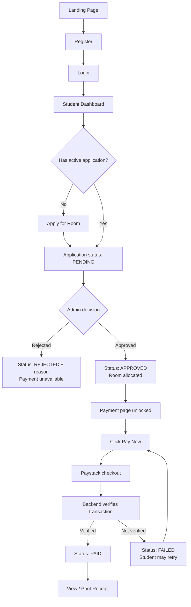
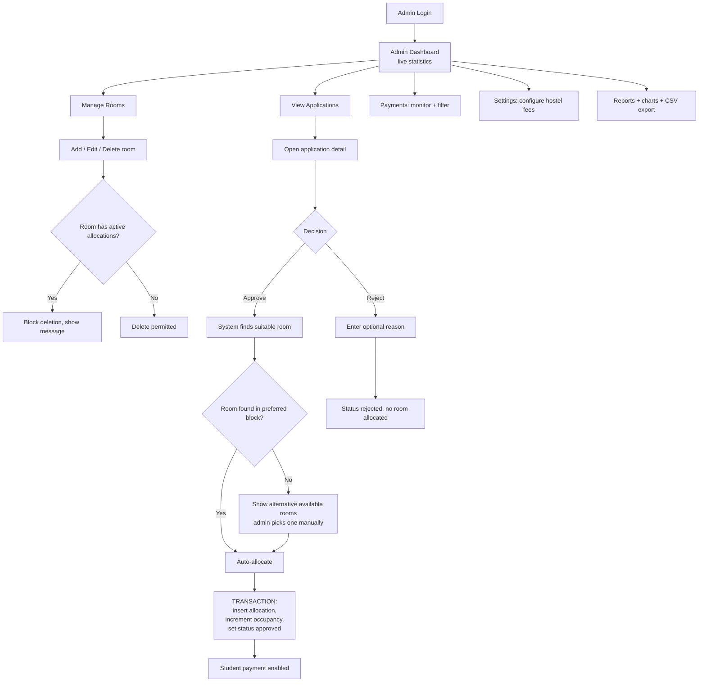
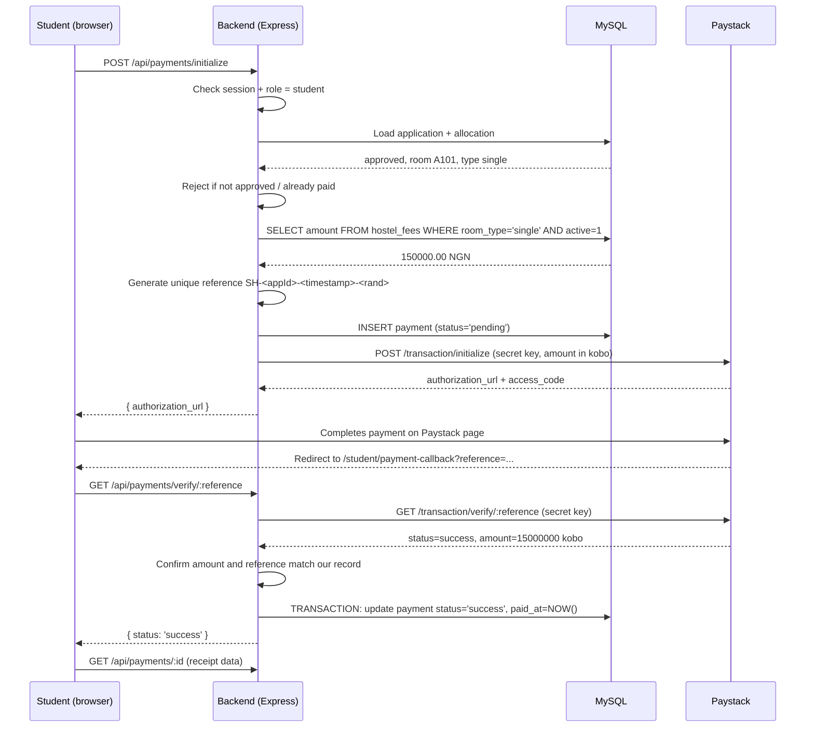
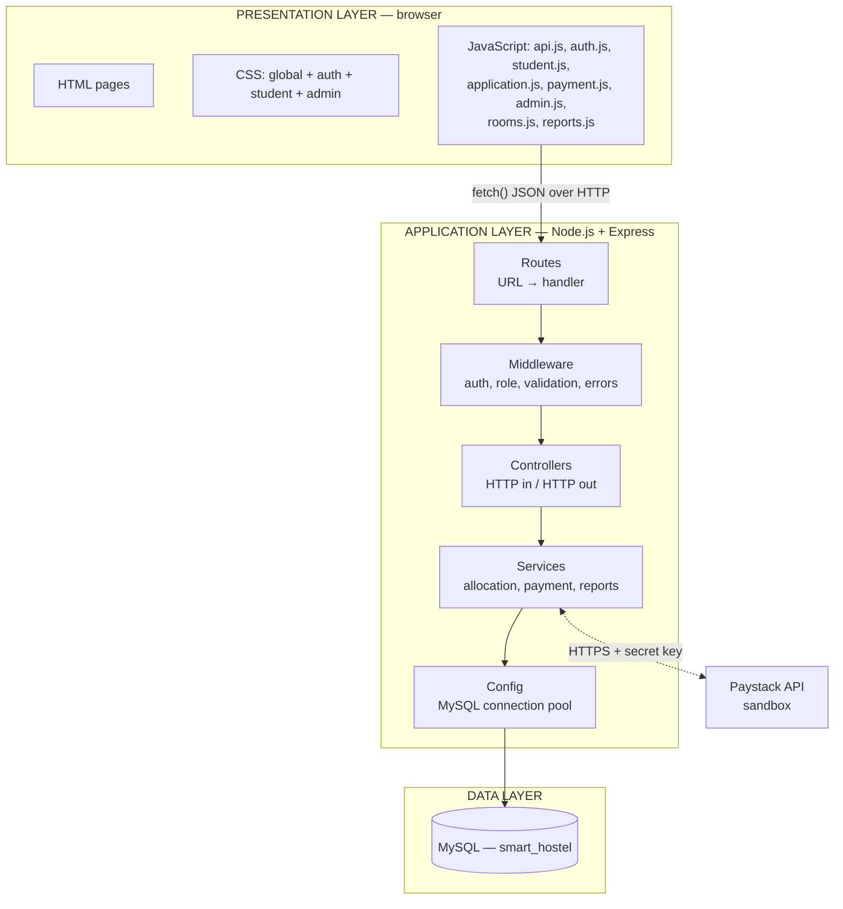
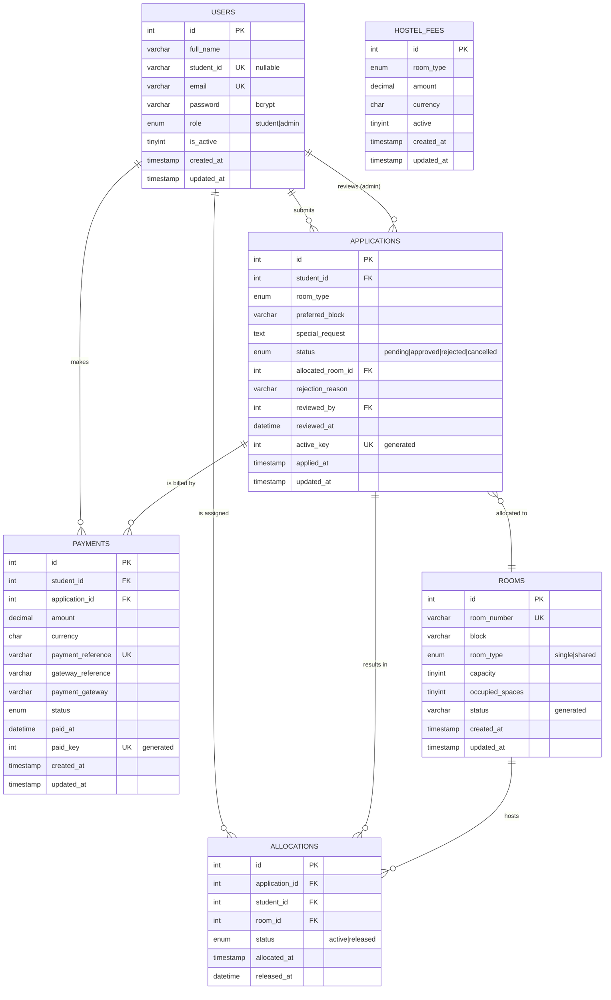

# Smart Hostel Room Allocation System
## Phase 1 — Requirements, System Architecture and Database Design

> **Note (added after Phase 5):** the project was renamed to **LASU Smart
> Hostel Allocation System** with a blue institutional colour scheme.
> This document is left as originally written for Phase 1 review; the
> name and colour appear updated everywhere in the actual application
> (frontend titles, sidebar, README) from Phase 5 onward.

**Project type:** Computer Science academic / SIWES project
**Stack:** HTML5 · CSS3 · Vanilla JavaScript · Node.js · Express.js · MySQL
**Status:** Design phase. No application code is written yet.

---

## 1. Final System Requirements

### 1.1 Problem statement

In most Nigerian universities, hostel allocation is still done with paper forms, physical queues at the hostel office, and manually maintained registers or spreadsheets. This produces four recurring problems:

1. **Double allocation** — two students are assigned the same bed space because two officers wrote in two different registers.
2. **No visibility** — a student who applied has no way to know their status without physically visiting the office.
3. **Payment disputes** — bank teller receipts get lost, and there is no reliable link between "this student paid" and "this student was allocated room A101".
4. **No data for planning** — the hostel office cannot quickly answer "how many spaces are still vacant in Block C?"

The Smart Hostel Room Allocation System digitises this entire process: application, review, allocation, payment and reporting.

### 1.2 Aim

To design and implement a secure, web-based hostel management system that automates student hostel application, room allocation, and online hostel fee payment, while maintaining a verifiable audit trail.

### 1.3 Objectives

1. Provide secure role-based registration and authentication for students and administrators.
2. Allow students to apply for hostel accommodation online and track application status in real time.
3. Enable administrators to review applications and allocate rooms with automatic capacity enforcement.
4. Guarantee that no room is ever allocated beyond its capacity, even under concurrent access.
5. Integrate a Nigerian payment gateway (Paystack sandbox) with **server-side** transaction verification.
6. Generate digital receipts and administrative reports with statistics and charts.

### 1.4 Scope

**In scope**

| Area | Covered |
|---|---|
| User management | Student self-registration, admin seeded accounts |
| Applications | Submit, track, approve, reject, one active application per student |
| Rooms | CRUD, capacity tracking, block/type organisation |
| Allocation | Automatic room matching + manual admin override, transaction-safe |
| Payments | Paystack initialize → verify → receipt, fees configured in database |
| Reports | Room, application and payment statistics, charts, CSV export |

**Out of scope (documented as Future Improvements)**

Email/SMS notifications, room-change or swap requests, roommate matching by preference, maintenance complaint tickets, multi-session/academic-year archiving, native mobile app, biometric check-in.

### 1.5 Functional requirements

**FR-01 – Student registration.** A visitor can register with full name, student ID, email and password. Student ID and email must be unique. Password is hashed with bcrypt before storage.

**FR-02 – Authentication.** Registered users can log in and log out. Sessions expire. Failed logins return a generic error message.

**FR-03 – Role separation.** A student account can never call an administrative endpoint. Authorisation is enforced on the backend, not by hiding buttons in the frontend.

**FR-04 – Profile.** A student can view their profile and update their full name and email. Student ID and role are immutable from the client.

**FR-05 – Room application.** A logged-in student can submit one application specifying room type, preferred block and an optional special request.

**FR-06 – Duplicate prevention.** A student with an application in `pending` or `approved` state cannot submit another. Enforced by a database constraint, not only by application logic.

**FR-07 – Status tracking.** A student can view their application ID, choices, status, allocated room (if any), rejection reason (if any) and timestamps.

**FR-08 – Room management.** An admin can create, edit and delete rooms. Room numbers are unique. Capacity must be at least 1. A room with active allocations cannot be deleted.

**FR-09 – Approval + allocation.** Approving an application finds a suitable room, creates an allocation record, increments room occupancy and sets the application to `approved` — all inside one database transaction.

**FR-10 – Rejection.** Rejecting an application stores an optional reason and a decision timestamp, and allocates no room.

**FR-11 – Capacity safety.** The system must never exceed a room's capacity or allocate the same space twice, including when two admins approve two applications for the last space simultaneously.

**FR-12 – Payment gating.** The payment action is only available when the student's application is `approved` and a room is allocated.

**FR-13 – Payment amount authority.** The amount charged is read from the `hostel_fees` table on the server, based on the allocated room's type. An amount sent from the browser is ignored.

**FR-14 – Payment verification.** A payment is marked `success` only after the backend independently confirms the transaction with the payment gateway using a secret key.

**FR-15 – Single successful payment.** An application can have at most one successful payment. Enforced by a database constraint.

**FR-16 – Receipt.** A student can view, print and download a receipt for any successful payment.

**FR-17 – Fee configuration.** An admin can set the active hostel fee per room type. Historic payments retain the amount actually paid.

**FR-18 – Reports.** An admin can view room, application and payment statistics with charts, and export them as CSV.

### 1.6 Non-functional requirements

| Category | Requirement |
|---|---|
| **Security** | bcrypt (cost 10+) password hashing; parameterised SQL only; HTTP-only session cookies; role checks on every protected route; secrets in `.env`; no card data ever stored; generic auth error messages |
| **Reliability** | All multi-step writes (allocation, payment confirmation) wrapped in transactions with row locking, so a crash mid-operation leaves no half-finished state |
| **Performance** | Indexed foreign keys and status columns; connection pooling; dashboard statistics served by aggregate SQL rather than fetching all rows into Node |
| **Usability** | Consistent design system shared between student and admin areas; clear status badges; confirmation dialogs before destructive actions; plain-English error messages |
| **Responsiveness** | Usable at 320px and above; sidebars collapse; tables scroll horizontally; cards reflow |
| **Maintainability** | Layered structure (routes → controllers → services → database); one responsibility per file; `.sql` script reproduces the whole schema from scratch |
| **Auditability** | `allocations` table is append-only history; every table carries `created_at` / `updated_at` |

---

## 2. Student Workflow



**Narrative.** A student lands on the public page, registers, and logs in. The dashboard summarises four things pulled live from the database: application status, room status, allocated room, payment status. Until the student applies, three of these read "None" / "Not Allocated" / "Unpaid". After applying, the application sits in `pending` and the payment page explicitly tells the student that payment is not yet available — this is deliberate, because charging a student before a room exists creates refund problems. Once an admin approves, the dashboard shows the room number and the payment button becomes active. After a verified payment, the receipt becomes available permanently in payment history.

---

## 3. Admin Workflow



**Narrative.** The admin never types a room number blindly. When approving, the backend proposes a room using the matching rules in §4 below; if the preferred block is full, the admin is shown the alternatives and makes the call. The commitment step is a single transaction, so an approval either fully succeeds (application updated + allocation recorded + occupancy incremented) or fully fails with nothing changed.

### 3.1 Room matching rules (used by the allocation service)

Candidate rooms are filtered by `room_type = application.room_type` and `occupied_spaces < capacity`, then ordered by:

1. Rooms in the student's `preferred_block` first.
2. Among those, the room with the **highest** current occupancy that is still not full — this packs students into partially-filled rooms and keeps empty rooms genuinely empty, instead of scattering one student into every room.
3. Then by room number, so the result is deterministic and repeatable during defence demonstrations.

If the list is empty for the preferred block, the same query is re-run without the block filter and the results are returned to the admin as suggestions rather than being auto-applied.

---

## 4. Payment Workflow



**Why the amount is checked twice.** The backend sets the amount when initializing, and checks it again on verification. This defeats the classic attack where a user tampers with the checkout request to pay ₦100 instead of ₦150,000 — if Paystack reports a different amount than our stored record, verification fails.

**Webhook.** A `POST /api/payments/webhook` endpoint will also be implemented, validating Paystack's `x-paystack-signature` HMAC-SHA512 header. This is the safety net for students who pay successfully but close the browser before redirect. Both paths converge on the same "mark as paid" service function, which is idempotent.

**Stored vs never stored.**

| Stored in our database | Never stored anywhere |
|---|---|
| Payment reference, amount, currency, gateway name, status, timestamps, student and application IDs | Card number, CVV, expiry, PIN, OTP, bank password, Paystack authorization codes for re-charging |

Card details are entered on Paystack's own hosted page. Our server never sees them, which keeps the project outside PCI-DSS scope.

---

## 5. System Architecture



### 5.1 Layer responsibilities

| Layer | Responsibility | Must not do |
|---|---|---|
| **HTML/CSS** | Structure and presentation | Contain business rules or hard-coded data |
| **JavaScript (frontend)** | Collect input, call the API, render responses, client-side convenience validation | Decide prices, trust its own validation, hold secret keys |
| **Routes** | Map URL + method to a controller, attach middleware | Contain logic or SQL |
| **Middleware** | Authentication, role authorisation, input validation, centralised error formatting | Query business tables |
| **Controllers** | Read the request, call a service, shape the HTTP response | Contain SQL or transaction logic |
| **Services** | Business rules: allocation algorithm, payment verification, report aggregation. Own the transactions | Know about `req`/`res` |
| **Config** | Connection pool, environment loading | Business logic |
| **MySQL** | Persistence, constraints, referential integrity, final line of defence against invalid data | — |

The reason for the services layer (an addition to your original structure) is the allocation algorithm. It is used from two places — approving an application and, later, any re-allocation feature — and it is the one piece of logic you will be questioned on hardest during defence. Keeping it in `services/allocationService.js` rather than buried in a controller makes it a single, testable, explainable unit.

---

## 6. Database Entities

Database name: **`smart_hostel`** · Engine: **InnoDB** (required for foreign keys and transactions) · Charset: **utf8mb4** · Minimum version: **MySQL 8.0** (for `CHECK` constraints and generated columns).

### 6.1 `users`

| Column | Type | Constraints | Purpose |
|---|---|---|---|
| `id` | INT UNSIGNED | PK, AUTO_INCREMENT | Surrogate key |
| `full_name` | VARCHAR(120) | NOT NULL | Display name |
| `student_id` | VARCHAR(30) | UNIQUE, NULL | Matriculation number. NULL for admins |
| `email` | VARCHAR(150) | UNIQUE, NOT NULL | Login identifier |
| `password` | VARCHAR(255) | NOT NULL | bcrypt hash (60 chars; 255 allows algorithm changes) |
| `role` | ENUM('student','admin') | NOT NULL, DEFAULT 'student' | Authorisation |
| `is_active` | TINYINT(1) | NOT NULL, DEFAULT 1 | Soft disable instead of deleting a user with payment history |
| `created_at` | TIMESTAMP | DEFAULT CURRENT_TIMESTAMP | Registration date |
| `updated_at` | TIMESTAMP | ON UPDATE CURRENT_TIMESTAMP | Last modification |

*Note:* `student_id` is nullable so admins can exist without a matriculation number. In MySQL a `UNIQUE` index permits multiple `NULL` values, so many admins can coexist while student IDs stay unique among students.

### 6.2 `rooms`

| Column | Type | Constraints | Purpose |
|---|---|---|---|
| `id` | INT UNSIGNED | PK, AUTO_INCREMENT | Surrogate key |
| `room_number` | VARCHAR(20) | UNIQUE, NOT NULL | e.g. `A101` |
| `block` | VARCHAR(50) | NOT NULL, INDEX | e.g. `Block A` |
| `room_type` | ENUM('single','shared') | NOT NULL, INDEX | Drives fee and matching |
| `capacity` | TINYINT UNSIGNED | NOT NULL, CHECK (capacity BETWEEN 1 AND 12) | Total bed spaces |
| `occupied_spaces` | TINYINT UNSIGNED | NOT NULL DEFAULT 0, CHECK (occupied_spaces <= capacity) | Current occupancy counter |
| `status` | VARCHAR(20) | GENERATED ALWAYS AS (CASE …) STORED | `vacant` / `partial` / `full` |
| `created_at`, `updated_at` | TIMESTAMP | | Audit |

Two design points worth defending:

- **`occupied_spaces` is a deliberate denormalisation.** The true occupancy could always be derived by counting rows in `allocations`. Storing a counter lets the allocation query filter available rooms in one indexed scan instead of a `GROUP BY` over the whole allocation history, and lets the `CHECK` constraint physically prevent over-allocation. The counter is only ever changed inside the same transaction that inserts or removes an allocation row, so it cannot drift.
- **`status` is a generated column**, computed from `capacity` and `occupied_spaces`. It therefore cannot contradict them — a class of bug that plagues manually-updated status columns.

### 6.3 `applications`

| Column | Type | Constraints | Purpose |
|---|---|---|---|
| `id` | INT UNSIGNED | PK, AUTO_INCREMENT | Application number shown to student |
| `student_id` | INT UNSIGNED | FK → `users(id)` ON DELETE CASCADE, INDEX | Applicant |
| `room_type` | ENUM('single','shared') | NOT NULL | Requested type |
| `preferred_block` | VARCHAR(50) | NOT NULL | Requested block |
| `special_request` | TEXT | NULL | Free-text note to admin |
| `status` | ENUM('pending','approved','rejected','cancelled') | NOT NULL DEFAULT 'pending', INDEX | Lifecycle |
| `allocated_room_id` | INT UNSIGNED | FK → `rooms(id)` ON DELETE RESTRICT, NULL | Convenience pointer to current room |
| `rejection_reason` | VARCHAR(255) | NULL | Shown to student |
| `reviewed_by` | INT UNSIGNED | FK → `users(id)` ON DELETE SET NULL, NULL | Which admin decided |
| `reviewed_at` | DATETIME | NULL | Decision timestamp |
| `applied_at` | TIMESTAMP | DEFAULT CURRENT_TIMESTAMP | Submission date |
| `updated_at` | TIMESTAMP | ON UPDATE CURRENT_TIMESTAMP | Last change |
| `active_key` | INT UNSIGNED | GENERATED, UNIQUE | Duplicate-application guard |

**The duplicate-application guard.** FR-06 says a student may not hold two live applications. Checking this in JavaScript alone is unsafe: two rapid clicks can both pass the check before either inserts. MySQL has no partial indexes, so the trick is a generated column:

```sql
active_key INT UNSIGNED
  GENERATED ALWAYS AS (
    IF(status IN ('pending','approved'), student_id, NULL)
  ) STORED,
UNIQUE KEY uq_active_application (active_key)
```

While an application is `pending` or `approved`, `active_key` holds the student's ID and the unique index blocks a second one. Once it becomes `rejected` or `cancelled`, `active_key` becomes `NULL`, and because unique indexes ignore `NULL`s, the student may apply again. The database enforces the rule; the controller simply catches the duplicate-key error and returns *"You already have an active hostel application."*

### 6.4 `allocations`

| Column | Type | Constraints | Purpose |
|---|---|---|---|
| `id` | INT UNSIGNED | PK, AUTO_INCREMENT | |
| `application_id` | INT UNSIGNED | FK → `applications(id)` ON DELETE CASCADE, INDEX | |
| `student_id` | INT UNSIGNED | FK → `users(id)` ON DELETE CASCADE, INDEX | Denormalised for fast reporting |
| `room_id` | INT UNSIGNED | FK → `rooms(id)` ON DELETE RESTRICT, INDEX | |
| `status` | ENUM('active','released') | NOT NULL DEFAULT 'active' | Supports future room changes |
| `allocated_at` | TIMESTAMP | DEFAULT CURRENT_TIMESTAMP | |
| `released_at` | DATETIME | NULL | |

This is the **audit trail**. `applications.allocated_room_id` answers "where is this student now?" in one join; `allocations` answers "who has ever occupied this room, and when?" — the question a hostel warden actually asks during a dispute. `ON DELETE RESTRICT` on `room_id` is what makes FR-08 possible: MySQL itself refuses to delete an occupied room.

### 6.5 `hostel_fees`

| Column | Type | Constraints | Purpose |
|---|---|---|---|
| `id` | INT UNSIGNED | PK, AUTO_INCREMENT | |
| `room_type` | ENUM('single','shared') | NOT NULL, INDEX | |
| `amount` | DECIMAL(10,2) | NOT NULL, CHECK (amount > 0) | Never `FLOAT` — see §11 |
| `currency` | CHAR(3) | NOT NULL DEFAULT 'NGN' | |
| `active` | TINYINT(1) | NOT NULL DEFAULT 1 | Only one active row per type |
| `created_at`, `updated_at` | TIMESTAMP | | |

Changing a fee inserts a new row and deactivates the old one rather than overwriting. The history of what the hostel charged each session is preserved.

### 6.6 `payments`

| Column | Type | Constraints | Purpose |
|---|---|---|---|
| `id` | INT UNSIGNED | PK, AUTO_INCREMENT | |
| `student_id` | INT UNSIGNED | FK → `users(id)` ON DELETE RESTRICT, INDEX | |
| `application_id` | INT UNSIGNED | FK → `applications(id)` ON DELETE RESTRICT, INDEX | |
| `amount` | DECIMAL(10,2) | NOT NULL | **Snapshot** of the fee at payment time |
| `currency` | CHAR(3) | NOT NULL DEFAULT 'NGN' | |
| `payment_reference` | VARCHAR(80) | UNIQUE, NOT NULL | Our reference, sent to and returned by the gateway |
| `gateway_reference` | VARCHAR(120) | NULL | Paystack's own transaction ID |
| `payment_gateway` | VARCHAR(30) | NOT NULL DEFAULT 'paystack' | |
| `status` | ENUM('pending','success','failed','abandoned','refunded') | NOT NULL DEFAULT 'pending', INDEX | |
| `paid_at` | DATETIME | NULL | Set only on verified success |
| `created_at`, `updated_at` | TIMESTAMP | | |
| `paid_key` | INT UNSIGNED | GENERATED, UNIQUE | One success per application |

**One successful payment per application (FR-15)** uses the same generated-column technique:

```sql
paid_key INT UNSIGNED
  GENERATED ALWAYS AS (IF(status = 'success', application_id, NULL)) STORED,
UNIQUE KEY uq_paid_application (paid_key)
```

Failed and abandoned attempts accumulate freely (which is what payment history should show), but a second row can never flip to `success` for the same application.

`ON DELETE RESTRICT` on payments is intentional: financial records must not vanish because someone deleted a user. That is why `users` has `is_active` for soft-disabling instead.

### 6.7 `sessions`

Created automatically by `express-mysql-session`. Stores `session_id`, `expires`, `data`. Including it in the schema explanation matters because a marker will ask where sessions live.

---

## 7. Database Relationships

| # | Relationship | Cardinality | Implemented by | Explanation |
|---|---|---|---|---|
| R1 | `users` → `applications` | 1 : N (0..1 active) | `applications.student_id` FK | A student may apply in several sessions over time, so the historical relationship is one-to-many; the `active_key` unique index restricts it to at most one *live* application at a time. |
| R2 | `applications` → `allocations` | 1 : N (0..1 active) | `allocations.application_id` FK | One approved application normally yields one allocation, but a room transfer would release the first and create a second — hence one-to-many with an `active` status. |
| R3 | `rooms` → `allocations` | 1 : N | `allocations.room_id` FK | A shared room with capacity 4 has up to 4 concurrent active allocations, plus every past occupant. |
| R4 | `users` → `allocations` | 1 : N | `allocations.student_id` FK | Direct link so "which room is student X in?" needs no join through applications. |
| R5 | `users` → `payments` | 1 : N | `payments.student_id` FK | A student accumulates payment attempts, at most one successful per application. |
| R6 | `applications` → `payments` | 1 : N (1 success) | `payments.application_id` FK + `uq_paid_application` | Retries are allowed; double charging is not. |
| R7 | `applications` → `rooms` | N : 1 | `applications.allocated_room_id` FK | Denormalised pointer so the student dashboard shows the room number without touching `allocations`. |
| R8 | `users` (admin) → `applications` | 1 : N | `applications.reviewed_by` FK | Accountability: every decision names the admin who made it. |
| R9 | `hostel_fees` → `payments` | Logical, by `room_type` | No FK | Deliberately *not* a foreign key. The payment stores the amount as a value, so fee edits never rewrite history. |
| R10 | `rooms` ↔ `users` | N : M | Resolved by `allocations` | `allocations` is the junction table for the many-to-many "students occupy rooms" relationship, carrying its own attributes (`allocated_at`, `status`). |

---

## 8. ER Diagram



**Reading the diagram in words** (useful for your written report, where you may need to describe it without the image):

The `USERS` entity is the centre of the model. It participates in three relationships as a student — *submits* applications, *is assigned* allocations, *makes* payments — and one as an administrator, *reviews* applications. `APPLICATIONS` is the workflow entity that ties everything together: it originates from a user, results in an allocation once approved, is billed by one or more payment attempts, and points to the room finally allocated. `ROOMS` is an independent entity managed by administrators; it connects to students only indirectly through `ALLOCATIONS`, which resolves the many-to-many relationship between students and rooms and simultaneously serves as the system's audit log. `HOSTEL_FEES` stands apart with no foreign key, supplying the authoritative price by room type at the moment a payment is created.

---

## 9. Proposed API Architecture

All endpoints are prefixed `/api`, exchange JSON, and return a consistent envelope:

```json
{ "success": true,  "message": "…", "data": { } }
{ "success": false, "message": "…", "errors": [ ] }
```

Access levels: **Public** · **Student** (valid session, role `student`) · **Admin** (valid session, role `admin`) · **Any** (any authenticated user).

### Authentication — `routes/auth.js`

| Method | Endpoint | Access | Purpose |
|---|---|---|---|
| POST | `/api/auth/register` | Public | Create a student account |
| POST | `/api/auth/login` | Public | Create a session (students and admins; role returned in response) |
| POST | `/api/auth/logout` | Any | Destroy session, clear cookie |
| GET | `/api/auth/me` | Any | Current user — used by every page on load to decide whether to redirect to login |

### Students — `routes/students.js`

| Method | Endpoint | Access | Purpose |
|---|---|---|---|
| GET | `/api/students/profile` | Student | Own profile |
| PUT | `/api/students/profile` | Student | Update name/email only |
| GET | `/api/students/dashboard` | Student | Aggregated card data in one call |
| GET | `/api/students` | Admin | Paginated student list with search |
| GET | `/api/students/:id` | Admin | One student with application and payment summary |

`GET /api/students/dashboard` is an addition to your list. Without it the dashboard would fire four separate requests and flicker as each resolves; one endpoint returning one object is both faster and easier to explain.

### Applications — `routes/applications.js`

| Method | Endpoint | Access | Purpose |
|---|---|---|---|
| POST | `/api/applications` | Student | Submit |
| GET | `/api/applications/my` | Student | Own current application |
| GET | `/api/applications` | Admin | All, filterable by `?status=` and `?block=` |
| GET | `/api/applications/:id` | Owner or Admin | Detail (ownership checked server-side) |
| GET | `/api/applications/:id/suggested-rooms` | Admin | Ranked candidate rooms for approval |
| PUT | `/api/applications/:id/approve` | Admin | Approve; optional `{ "room_id": n }` override |
| PUT | `/api/applications/:id/reject` | Admin | Reject with optional reason |

### Rooms — `routes/rooms.js`

| Method | Endpoint | Access | Purpose |
|---|---|---|---|
| GET | `/api/rooms` | Admin | Full list with occupancy |
| GET | `/api/rooms/blocks` | Any | Distinct blocks — populates the student's dropdown from the database |
| GET | `/api/rooms/availability` | Any | Public availability summary per block/type |
| POST | `/api/rooms` | Admin | Create |
| PUT | `/api/rooms/:id` | Admin | Update (capacity cannot drop below current occupancy) |
| DELETE | `/api/rooms/:id` | Admin | Delete, blocked if allocations exist |

### Payments — `routes/payments.js`

| Method | Endpoint | Access | Purpose |
|---|---|---|---|
| GET | `/api/payments/status` | Student | What the payment page should render |
| POST | `/api/payments/initialize` | Student | Create reference, return `authorization_url` |
| GET | `/api/payments/verify/:reference` | Student | Server-side verification with Paystack |
| POST | `/api/payments/webhook` | Public + signature | Gateway callback, HMAC verified |
| GET | `/api/payments/my` | Student | Own payment history |
| GET | `/api/payments/:id` | Owner or Admin | Receipt data |
| GET | `/api/payments` | Admin | All payments with filters |

### Fees — `routes/fees.js`

| Method | Endpoint | Access | Purpose |
|---|---|---|---|
| GET | `/api/fees` | Any | Active fees for display only |
| PUT | `/api/fees/:room_type` | Admin | Set a new active fee |

### Reports — `routes/reports.js`

| Method | Endpoint | Access | Purpose |
|---|---|---|---|
| GET | `/api/reports/rooms` | Admin | Room statistics |
| GET | `/api/reports/applications` | Admin | Application statistics |
| GET | `/api/reports/payments` | Admin | Revenue statistics |
| GET | `/api/reports/dashboard` | Admin | All dashboard counters in one call |
| GET | `/api/reports/export/:type` | Admin | CSV download |

---

## 10. Project Folder Structure

```text
smart-hostel-system/
│
├── frontend/
│   ├── index.html                  landing page
│   ├── register.html
│   ├── login.html
│   │
│   ├── student/
│   │   ├── dashboard.html
│   │   ├── profile.html
│   │   ├── apply-room.html
│   │   ├── application.html
│   │   ├── payment.html
│   │   ├── payment-callback.html   gateway redirect target
│   │   ├── payment-history.html
│   │   └── receipt.html
│   │
│   ├── admin/
│   │   ├── login.html
│   │   ├── dashboard.html
│   │   ├── rooms.html
│   │   ├── applications.html
│   │   ├── students.html
│   │   ├── payments.html
│   │   ├── settings.html           hostel fee configuration
│   │   └── reports.html
│   │
│   ├── css/
│   │   ├── global.css              design tokens, reset, buttons, badges
│   │   ├── auth.css
│   │   ├── student.css
│   │   └── admin.css
│   │
│   └── js/
│       ├── api.js                  fetch wrapper, error handling, redirect on 401
│       ├── ui.js                   toasts, modals, badges, table helpers
│       ├── auth.js
│       ├── student.js
│       ├── application.js
│       ├── payment.js
│       ├── admin.js
│       ├── rooms.js
│       └── reports.js
│
├── backend/
│   ├── server.js                   entry point, middleware order, static serving
│   ├── app.js                      express app, separated for testability
│   ├── package.json
│   ├── .env                        gitignored
│   ├── .env.example                committed template
│   │
│   ├── config/
│   │   ├── database.js             mysql2 promise pool
│   │   └── session.js              express-session + MySQL store
│   │
│   ├── routes/
│   │   ├── index.js                mounts all routers
│   │   ├── auth.js
│   │   ├── students.js
│   │   ├── rooms.js
│   │   ├── applications.js
│   │   ├── payments.js
│   │   ├── fees.js
│   │   └── reports.js
│   │
│   ├── controllers/
│   │   ├── authController.js
│   │   ├── studentController.js
│   │   ├── roomController.js
│   │   ├── applicationController.js
│   │   ├── paymentController.js
│   │   ├── feeController.js
│   │   └── reportController.js
│   │
│   ├── services/
│   │   ├── allocationService.js    the allocation algorithm + transaction
│   │   ├── paymentService.js       Paystack init, verify, webhook handling
│   │   └── reportService.js        aggregate SQL
│   │
│   ├── middleware/
│   │   ├── authMiddleware.js       requireAuth, requireRole('admin')
│   │   ├── validate.js             express-validator runner
│   │   ├── notFound.js
│   │   └── errorMiddleware.js      central handler, hides SQL errors
│   │
│   ├── validators/
│   │   ├── authValidator.js
│   │   ├── applicationValidator.js
│   │   └── roomValidator.js
│   │
│   ├── utils/
│   │   ├── reference.js            payment reference generator
│   │   ├── csv.js                  array → CSV
│   │   └── ApiError.js             error class carrying an HTTP status
│   │
│   └── scripts/
│       └── seedAdmin.js            creates the first admin from .env, prompts for password
│
├── database/
│   ├── hostel.sql                  schema + constraints + indexes + sample data
│   └── reset.sql                   drop and recreate, for demo runs
│
├── docs/
│   ├── phase1-design.md            this document
│   ├── er-diagram.png
│   └── testing-checklist.md
│
├── README.md
└── .gitignore
```

**Changes from your original structure and why**

| Addition | Reason |
|---|---|
| `services/` | Keeps the allocation and payment logic out of controllers; it is the part you will be examined on |
| `validators/` | Input rules live beside each other instead of scattered through controllers |
| `app.js` split from `server.js` | The Express app can be imported by tests without opening a port |
| `.env.example` | `.env` is gitignored, so the repository still needs to document required variables |
| `scripts/seedAdmin.js` | Safer than putting a bcrypt hash in a public `.sql` file |
| `payment-callback.html` | Paystack needs a redirect URL that then calls the verify endpoint |
| `admin/settings.html` | FR-17, which had no page in the original list |
| `js/ui.js` | Toasts and modals are reused everywhere; without this file they get copy-pasted into six files |

---

## 11. Important Design Decisions

### 11.1 Sessions rather than JWT

**Decision:** `express-session` with `express-mysql-session` as the store, HTTP-only cookies.

**Why.** JWT is popular, but popularity is not a reason. The deciding factors here:

1. **Same-origin architecture.** Express serves the HTML *and* the API. A cookie is sent automatically by the browser with every `fetch`; there is no cross-domain problem to solve. JWT's main advantage — statelessness across separate domains and services — buys this project nothing.
2. **Where would the token live?** In a vanilla-JS frontend, a JWT ends up in `localStorage`, which any injected script can read. An HTTP-only cookie is invisible to JavaScript, which removes the most likely token-theft path in a student project.
3. **Logout must actually work.** Destroying a session row logs the user out immediately. A JWT remains valid until it expires; implementing real logout requires a server-side blocklist — which is a session table wearing a disguise.
4. **Defence question.** "What happens if a student's account is disabled mid-session?" With sessions: the next request fails. With JWT: they keep full access until expiry.

**Trade-off to acknowledge:** sessions require server-side state, so horizontal scaling needs a shared store. We have one — MySQL — so this costs nothing. A default in-memory store would *not* be acceptable, since it loses every login on server restart.

**Cookie configuration:** `httpOnly: true`, `sameSite: 'lax'` (allows the Paystack redirect to return with the session intact), `secure: true` in production only, `maxAge` 2 hours with rolling renewal.

### 11.2 Transactions and row locking for allocation

This is the heart of the project. Two admins approving two applications for the last space in room B201 must not both succeed. The sequence inside `allocationService.allocateRoom()`:

```sql
START TRANSACTION;
  SELECT status FROM applications WHERE id = ? FOR UPDATE;      -- lock the application
  -- abort if status is no longer 'pending'
  SELECT id, capacity, occupied_spaces FROM rooms
    WHERE id = ? FOR UPDATE;                                    -- lock the room row
  -- abort if occupied_spaces >= capacity
  INSERT INTO allocations (...) VALUES (...);
  UPDATE rooms SET occupied_spaces = occupied_spaces + 1 WHERE id = ?;
  UPDATE applications
     SET status = 'approved', allocated_room_id = ?, reviewed_by = ?, reviewed_at = NOW()
   WHERE id = ?;
COMMIT;
```

`SELECT … FOR UPDATE` places an exclusive lock on the room row. The second admin's transaction blocks at that line until the first commits, then reads `occupied_spaces = capacity` and aborts cleanly with *"No suitable room is currently available."* Without the lock, both would read the stale value and both would increment — the classic lost-update race.

The `CHECK (occupied_spaces <= capacity)` constraint is the backstop: even if the locking logic were wrong, the database would reject the over-allocation rather than silently corrupt the data. Two independent defences for the same rule is correct engineering, not redundancy.

### 11.3 The frontend is never trusted

Three concrete applications of this principle:

- **Amount.** `POST /api/payments/initialize` accepts no amount parameter at all. There is nothing to tamper with.
- **Ownership.** `GET /api/applications/:id` does not just check that the caller is logged in; it checks `application.student_id === session.user.id` unless the caller is an admin. Otherwise any student could read every application by incrementing the ID — an IDOR vulnerability.
- **Role.** Hiding the admin sidebar from students is cosmetic. `requireRole('admin')` on the route is the actual control.

### 11.4 `DECIMAL`, not `FLOAT`, for money

`FLOAT` and `DOUBLE` are binary approximations; `0.1 + 0.2` is not `0.3`. Summing thousands of hostel fees stored as floats produces a total that is wrong in the kobo and impossible to reconcile. `DECIMAL(10,2)` stores exact values up to ₦99,999,999.99. Additionally, Paystack transacts in **kobo** (integer), so the service layer converts `amount * 100` on initialize and divides on verify — a unit mismatch that causes real bugs if you forget it.

### 11.5 Payment stores a snapshot, not a reference

`payments.amount` is a copied value with no foreign key to `hostel_fees`. If the hostel raises the single-room fee next session, last session's receipts must still read ₦150,000. Linking by foreign key would silently rewrite history. This is the standard invoicing pattern and a good point to raise in your report.

### 11.6 Payment availability is a server-computed state

Rather than the frontend inferring what to show from several fields, `GET /api/payments/status` returns an explicit state and message:

```json
{
  "state": "payable",
  "message": null,
  "application": { "id": 12, "status": "approved" },
  "room": { "room_number": "A101", "block": "Block A", "room_type": "single" },
  "fee": { "amount": "150000.00", "currency": "NGN" },
  "payment": null
}
```

`state` is one of `no_application`, `pending_review`, `rejected`, `payable`, `processing`, `paid`, `failed`. The page renders a branch per state. The rule "payment is only available after approval" then exists in exactly one place in the codebase — and that place is the server.

### 11.7 Validation happens at three levels

| Level | Tool | Purpose |
|---|---|---|
| Client | JavaScript + HTML5 attributes | Fast feedback; a convenience only |
| Server | express-validator | The real gate. Type, length, format, enum membership |
| Database | NOT NULL, UNIQUE, CHECK, FK, ENUM | Last line of defence; protects data even against a bug in our own code |

### 11.8 Parameterised queries everywhere

Every query uses `mysql2` placeholders:

```js
// safe — the driver sends value and query separately
await pool.execute('SELECT * FROM users WHERE email = ?', [email]);

// never — string concatenation allows: ' OR '1'='1
await pool.query(`SELECT * FROM users WHERE email = '${email}'`);
```

`pool.execute()` uses prepared statements, so user input can never be parsed as SQL. This single habit closes the entire SQL-injection class.

### 11.9 Centralised error handling

Controllers throw `ApiError` objects; one Express error middleware formats every response. Users see *"Unable to complete your request. Please try again."*; the full stack and SQL message go to the server log only. Leaking `ER_DUP_ENTRY for key 'users.email'` tells an attacker which emails are registered.

### 11.10 Paystack over Flutterwave

Both are viable. Paystack is chosen because its sandbox needs no business verification to start testing, its `initialize` / `verify` API pair is minimal enough to explain in a defence, and its test card numbers are well documented. The gateway name is stored per payment row and the integration lives entirely in `services/paymentService.js`, so switching to Flutterwave later means editing one file — not the database.

---

## Phase 1 Summary

**What this phase produced:** the complete specification the remaining thirteen phases will implement — requirements, three workflows, layered architecture, a six-table relational schema with every constraint justified, a REST API surface, a folder structure, and the reasoning behind ten design decisions you will be asked to defend.

**Files created:** `docs/phase1-design.md` (this document). No code yet, by design.

**How to review this phase**

1. Confirm the two roles and their permissions match your project requirements.
2. Confirm the application lifecycle — is `cancelled` (student withdraws) a state you want? It is included but unused so far.
3. Confirm the room model. Does your hostel need a `gender` attribute on blocks or rooms? Many Nigerian universities have male and female hostels; adding it later means a schema migration, so decide now.
4. Confirm the fee model. One fee per room type, or per block as well?
5. Confirm MySQL 8.0 is available in your environment — generated columns and `CHECK` constraints need it. If you are on 5.7, say so and I will substitute triggers.

**Known gaps to settle before Phase 3**

- Gender segregation of blocks is not modelled.
- Academic session / year is not modelled, so the system holds one allocation cycle at a time.
- Room-change requests are anticipated in the schema (`allocations.status`) but have no workflow.

**Next:** Phase 2 — project folder setup, Node.js and Express bootstrap.
